# PrideMediaDB

> **TODO:** Add responsive mock-up here

*Responsive mock-up of the completed PrideMediaDB application, demonstrating its responsive design across desktop, tablet and mobile devices.*

[Live Site](TODO) | [GitHub Repository](https://github.com/David-CB-UK/PrideMediaDB/)

---

## Table of Contents

1. [Project Overview](#project-overview)
2. [User Experience (UX)](#user-experience-ux)
   * [Project Purpose](#project-purpose)
   * [User Goals](#user-goals)
   * [User Goals and User Stories](#user-goals-and-user-stories)
   * [User Experience Goals](#user-experience-goals)
   * [Accessibility](#accessibility)
3. [Project Management](#project-management)
   * [Agile Development](#agile-development)
   * [GitHub Project Board](#github-project-board)
   * [Epics](#epics)
   * [User Stories and Acceptance Criteria](#user-stories-and-acceptance-criteria)
   * [MoSCoW Prioritisation](#moscow-prioritisation)
   * [Backlog Refinement](#backlog-refinement)
   * [Development Workflow](#development-workflow)
4. [Design](#design)
   * [Research and Design Inspiration](#research-and-design-inspiration)
   * [Visual Design](#visual-design)
   * [Colour Scheme](#colour-scheme)
   * [Typography](#typography)
   * [Logo and Branding](#logo-and-branding)
   * [Favicon & App Icons](#favicon--app-icons)
   * [Wireframes](#wireframes)
5. [Features](#features)
   * [Planned Features](#planned-features)
   * [Implemented Features](#implemented-features)
   * [Responsive Design](#responsive-design)
   * [User Authentication](#user-authentication)
   * [Film Discovery and Search](#film-discovery-and-search)
   * [Film Details and Representation](#film-details-and-representation)
   * [Ratings, Reviews and Watchlists](#ratings-reviews-and-watchlists)
6. [Database](#database)
   * [Database Design](#database-design)
   * [Database Design Diagrams](#database-design-diagrams)
   * [Proposed Django Models](#proposed-django-models)
7. [API Integration](#api-integration)
   * [API Research](#api-research)
   * [TMDb Integration](#tmdb-integration)
   * [API Feedback and Error Handling](#api-feedback-and-error-handling)
8. [Technologies Used](#technologies-used)
   * [Languages](#languages)
   * [Frameworks and Libraries](#frameworks-and-libraries)
   * [Database Technology](#database-technology)
   * [Development and Version Control](#development-and-version-control)
9. [Testing](#testing)
10. [Deployment](#deployment)
11. [Project Structure](#project-structure)
12. [Credits](#credits)
13. [References](#references)
14. [Acknowledgements](#acknowledgements)
15. [Future Development](#future-development)
16. [Reflections](#reflections)

---

## Project Overview

[Back to top](#pridemediadb)

---

## User Experience (UX)

[Back to top](#pridemediadb)

---

### Project Purpose

PrideMediaDB is being developed to provide a dedicated resource for discovering and exploring LGBTQ+ films and understanding the representation and context within them.

While existing film databases provide extensive general information about films, information relating specifically to LGBTQ+ representation, themes and context can be more difficult to find and is often spread across multiple sources. Research carried out during the planning of this project also identified gaps, duplicates, inconsistent categorisation and information requiring further verification within existing LGBTQ+ film resources.

PrideMediaDB aims to address this by providing a focused, structured database of LGBTQ+ film information, allowing users to discover films and explore information such as LGBTQ+ representation, themes, age ratings and other relevant details. External services can be used to complement this information rather than being recreated within the project.

Users will also be able to keep track of films they are interested in or have watched, rate and review films, contribute film suggestions, and share film information or their reviews with others who may be interested.

The project is designed to provide an accessible, responsive and engaging experience across desktop, tablet and mobile devices, with additional features and enhancements planned for future development.

[Back to top](#pridemediadb)

---

### User Goals

PrideMediaDB is designed around the following user goals:

- **Discover films** — Browse, search and filter the database to find LGBTQ+ films that match their interests.
- **Explore films and representation** — View detailed film information and explore LGBTQ+ representation, themes, categories, age ratings and other relevant information.
- **Explore additional film information** — Access relevant metadata and links to trusted external film information and ratings, including information provided through integrated external services.
- **Keep track of films** — Add films to a personal Watchlist and mark films as watched.
- **Rate and review films** — Create, view, edit and delete personal ratings and reviews to record and share opinions about films.
- **Contribute to the database** — Suggest films that may be missing from PrideMediaDB for consideration and approval.
- **Share film information** — Share individual film pages with others through social media or messaging services.
- **Use the application easily and accessibly** — Navigate and use PrideMediaDB effectively across desktop, tablet and mobile devices, including users with different accessibility needs.

These goals provide the foundation for the user stories and acceptance criteria used to plan and develop the project.

[Back to top](#pridemediadb)

---

### User Goals and User Stories

The user goals identified for PrideMediaDB are translated into user stories that describe what users need to accomplish and why. These stories provide the basis for the acceptance criteria used during development.

| User Goal | User Stories |
|---|---|
| **Discover films** | As a visitor, I want to browse and search the film database so that I can discover LGBTQ+ films that interest me. |
| **Explore films and representation** | As a visitor, I want to view detailed film information and LGBTQ+ representation so that I can understand what a film is about and how LGBTQ+ representation is presented. |
| **Explore additional film information** | As a visitor, I want to access relevant film metadata, external information and ratings so that I can explore information from additional trusted sources. |
| **Keep track of films** | As a registered user, I want to add films to my Watchlist and mark films as watched so that I can keep track of films I want to see and have already watched. |
| **Rate and review films** | As a registered user, I want to create, edit and delete my ratings and reviews so that I can record and share my opinions about films. |
| **Contribute to the database** | As a registered user, I want to suggest films that are missing from the database so that they can be considered for inclusion. |
| **Manage film suggestions** | As an administrator, I want to review and approve or reject suggested films so that only appropriate and relevant films are added to the database. |
| **Manage film data** | As an administrator, I want to add, edit and manage film information so that the database remains accurate and up to date. |
| **Share film information** | As a visitor, I want to share an individual film page so that I can recommend or discuss a film with others. |
| **Use the application easily and accessibly** | As a user, I want the application to be responsive, accessible and easy to navigate so that I can use it effectively across different devices and accessibility needs. |

The user stories are managed through the project's GitHub Issues and Project Board; [GitHub Issues](https://github.com/David-CB-UK/PrideMediaDB/issues). Acceptance criteria are used to define when each story has been completed.

[Back to top](#pridemediadb)

---

### User Experience Goals

[Back to top](#pridemediadb)

---

### Accessibility

[Back to top](#pridemediadb)

---

## Project Management

[Back to top](#pridemediadb)

---

### Agile Development

[Back to top](#pridemediadb)

---

### GitHub Project Board

[Back to top](#pridemediadb)

---

### Epics

[Back to top](#pridemediadb)

---

### User Stories and Acceptance Criteria

[Back to top](#pridemediadb)

---

### MoSCoW Prioritisation

[Back to top](#pridemediadb)

---

### Backlog Refinement

[Back to top](#pridemediadb)

---

### Development Workflow

[Back to top](#pridemediadb)

---

## Design

[Back to top](#pridemediadb)

---

### Research and Design Inspiration

[Back to top](#pridemediadb)

---

### Visual Design

[Back to top](#pridemediadb)

---

### Colour Scheme

The PrideMediaDB colour scheme is designed around a modern, cinematic interface for discovering and exploring LGBTQ+ film and media. The primary visual direction uses deep navy and blue-grey tones to create a strong dark interface, with a corresponding light theme using the same visual relationships and a neutral light background.

The **dark theme is the primary visual direction**, as it provides strong contrast with film imagery and allows the colourful PrideMediaDB branding to stand out. A light theme is also planned as a companion option to support **accessibility and user preference**. Providing a choice of theme allows users to select the viewing experience they find most comfortable, while both themes will maintain appropriate colour contrast and readability.

A limited core palette was selected to keep the interface visually consistent and avoid excessive use of colour. The two themes were developed using **[Coolors](https://coolors.co/)** and will be reviewed during implementation and accessibility testing.

#### Dark Theme

<strong>Dark Theme Colour Palette</strong> (Click to expand)

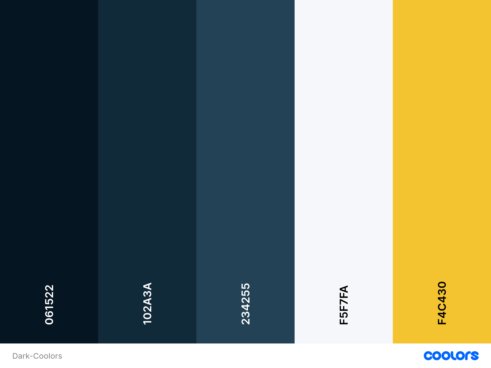

*Colour palette created using Coolors, illustrating the primary colours used throughout the PrideMediaDB dark theme.*

The dark theme uses deep navy and blue-grey tones as its foundation, with a warm yellow accent used for primary actions, ratings and selected interface highlights.

#### Light Theme

<strong>Light Theme Colour Palette</strong> (Click to expand)

*Colour palette created using Coolors, illustrating the primary colours used throughout the PrideMediaDB light theme.*

The light theme uses lighter neutral surfaces and dark navy text while retaining the same visual identity as the dark theme. It is intended as a companion theme rather than a separate colour scheme.

#### PrideMediaDB Rainbow Gradient

The PrideMediaDB rainbow gradient is a separate **brand treatment** rather than part of the core colour palette. It provides the distinctive rainbow identity of the project while allowing the main interface to remain visually controlled.

<strong>Rainbow Gradient Examples</strong> (Click to expand)

*Examples of the PrideMediaDB rainbow gradient applied to selected interface elements, including buttons, progress and rating bars, navigation highlights, badges and accent lines.*

 

The gradient will be implemented using CSS and reused consistently across selected elements, including the logo, progress and rating bars, and other visual highlights. The final gradient will use smooth transitions between rich rainbow tones rather than treating each colour as a separate block. Representation labels will use colours associated with their relevant Pride flags where appropriate, rather than using the general PrideMediaDB gradient for every category.

[Back to top](#pridemediadb)

---
### Typography

[Back to top](#pridemediadb)

---

### Logo and Branding

PrideMediaDB uses a distinctive rainbow-gradient wordmark to reflect the project's focus on LGBTQ+ film and media while maintaining a professional and contemporary visual identity.

The logo combines the PRIDEMEDIADB wordmark with the tagline "Find it. Watch it. Celebrate it." The gradient moves through a range of warm and cool rainbow tones, creating a consistent visual connection with the project's wider colour scheme.

The visual identity was developed from my own design ideas and refined through an iterative process using ChatGPT. ChatGPT was used to explore and develop visual concepts from my prompts and design requirements, with the final design decisions, colour choices and overall branding selected and reviewed by me.

The logo uses a transparent background to allow flexible placement within the application. Both light and dark backgrounds were considered during the design process; however, the logo has the strongest visual impact against a dark or black background, where the rainbow gradient and white tagline provide greater contrast and visual emphasis. The final interface will therefore use the logo primarily within the dark visual theme, while ensuring branding remains recognisable across the wider design system.

The logo has been provided in WebP format to reduce file size while maintaining visual quality and supporting website performance.

<strong>PrideMediaDB Logo</strong> (Click to expand)

### Dark background

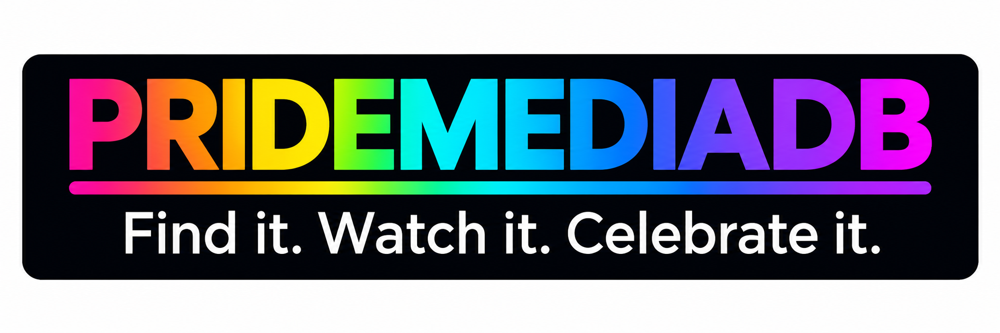

### Light background

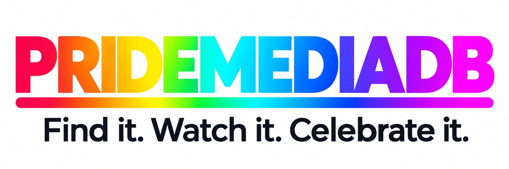

[Back to top](#pridemediadb)

---

#### Favicon & App Icons

The PrideMediaDB favicon and app icon uses a ring and play symbol as a simple and recognisable extension of the main brand identity. The rainbow treatment connects the icon to the wider PrideMediaDB visual design, while the simplified form allows it to remain clear at small sizes.

Multiple icon formats and sizes are used to support consistent branding across desktop browsers, search results and mobile devices.

<strong>Browser Favicon</strong> (Click to expand)

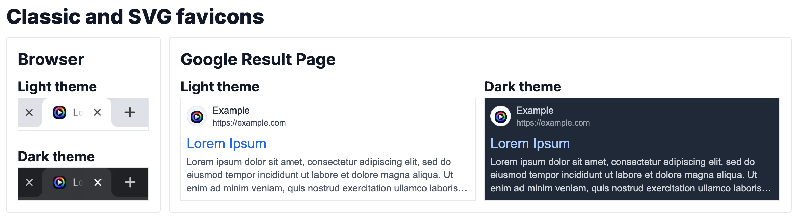

*PrideMediaDB favicon shown in browser tabs and Google search results in both light and dark themes.*

 

<strong>Android App Icons</strong> (Click to expand)

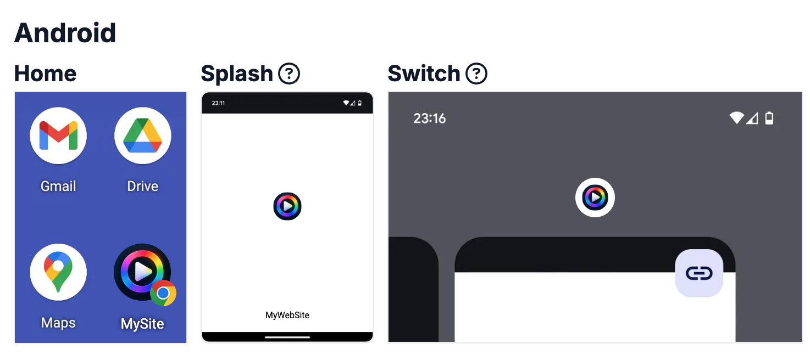

*PrideMediaDB icon shown in Android home-screen, splash-screen and app-switcher contexts.*

 

<strong>iOS App Icon</strong> (Click to expand)

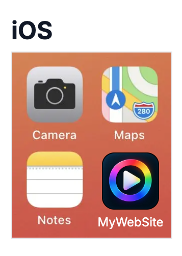

*PrideMediaDB icon shown as an iOS home-screen app icon.*

 

**UX Rationale:**  
Using a consistent favicon and app icon across browsers and mobile devices helps users recognise PrideMediaDB quickly when browsing, switching between applications, bookmarking the site or adding it to a device home screen. The icon also maintains the visual connection between the main PrideMediaDB wordmark and the wider film/media branding.

[Back to top](#pridemediadb)

---

### Wireframes

This section documents the planning and design of the PrideMediaDB user interface, from initial wireframes to more detailed visual mock-ups.

ChatGPT was used as a design aid to explore layouts, generate visual concepts and develop alternative approaches. Unlike my previous projects, in this project, I wanted to explore how AI-assisted design could help me develop ideas, compare different layouts and produce visual examples before implementation and in doing so possibly speed up the initial design process.

The results varied, and some designs required repeated revisions to get closer to what I wanted. Even after several attempts, some details did not turn out as intended, but the designs could still provide useful examples and ideas to work from.

Design decisions remained guided by the project's requirements and my own preferences. This included selecting useful layouts and features, rejecting unsuitable alternatives, refining the colour schemes and branding, and considering how the interface should work for different users. The aim was not to accept every generated design as a finished product, but to use the most useful elements as a basis for further planning and development.

The wireframes are being reviewed and organised by page and feature. Low-fidelity wireframes will help establish page structure and functionality, while selected high-fidelity mock-ups will provide more detailed visual references. Not every page requires a high-fidelity design, and logged-in and logged-out versions are included where the user experience differs.

The designs will be refined as necessary to maintain consistency with the agreed branding, user stories, acceptance criteria, accessibility considerations and responsive layout requirements. The wireframes support the planning process; implementation and functionality will be developed and tested separately in accordance with the project's Test-Driven Development (TDD) requirements.

**Wireframes and delivery scope**

The wireframes illustrate the proposed user experience and may include features that are not planned for implementation during the current Project 3 delivery period. Final implementation scope will be determined by the MoSCoW prioritisation of user stories and requirements, taking account of the project assessment criteria, available development time and technical feasibility.

Features marked as *Could Have* may be deferred if time or technical constraints prevent implementation. Features explicitly excluded from the current release will be documented as *Won't Have* for this delivery period, without necessarily ruling them out as future enhancements.

<strong>1. Homepage</strong> (Click to expand)

#### Logged-out homepage — Low resolution

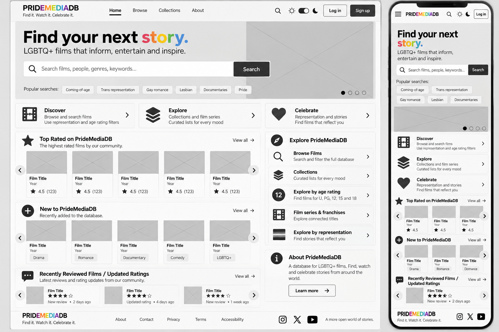

This wireframe shows the main homepage layout for visitors who are not signed in.

#### Logged-in homepage — Low resolution

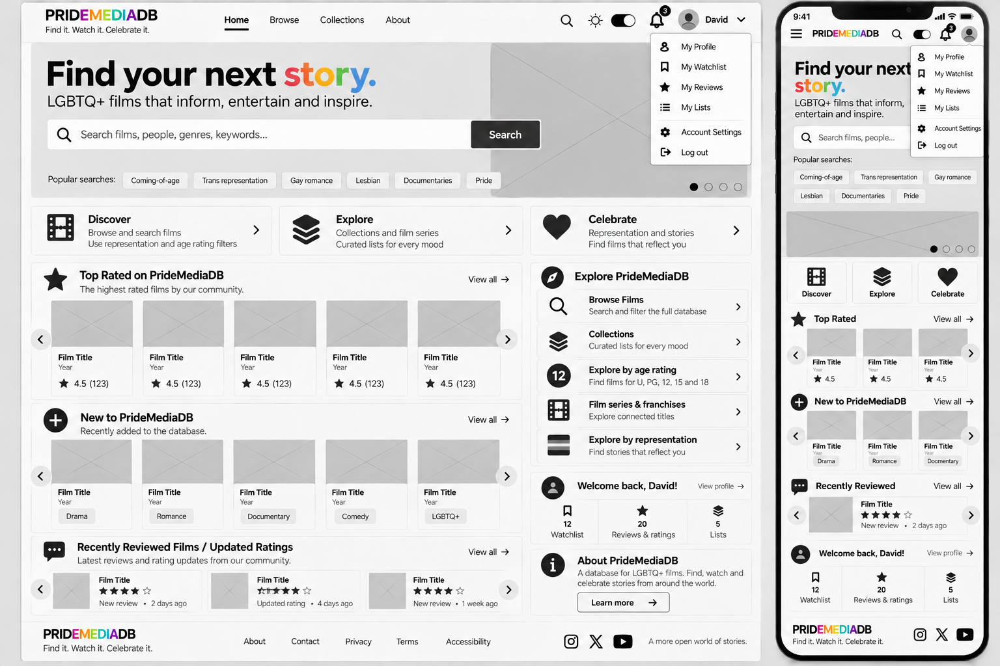

This wireframe will show the homepage available to signed-in users.

#### Logged-out homepage — High resolution Dark

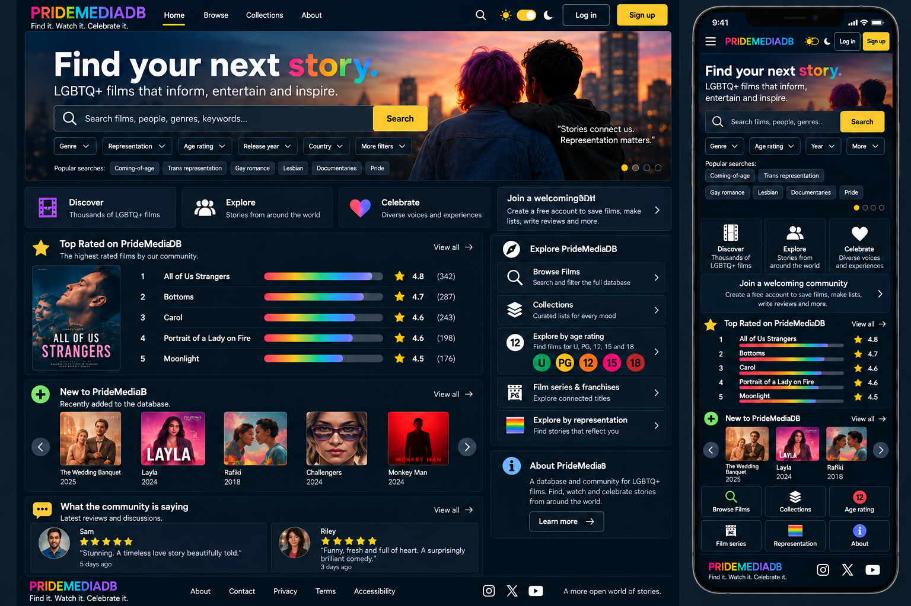

This design develops the logged-out low res homepage into a more detailed visual mock-up using the dark theme.

#### Logged-out homepage — High resolution Light

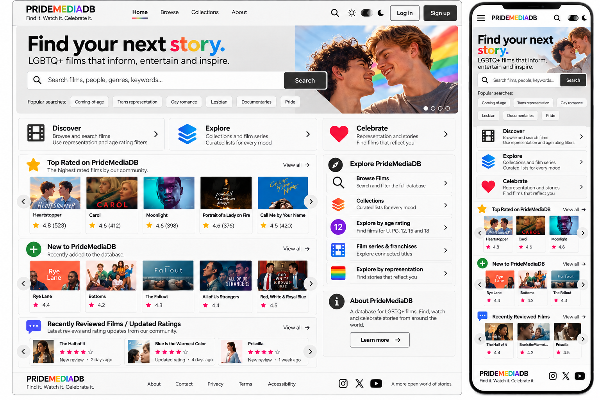

This design provides a light-theme version of the logged-out homepage.

<strong>2. Browse Films and Search Results</strong> (Click to expand)

#### Browse films / Search results Page

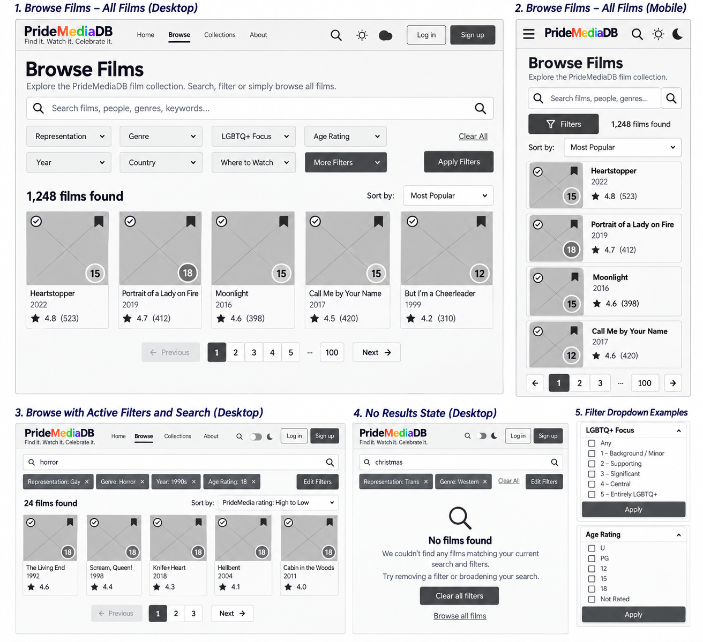

This wireframe shows how users browse the film database and explore available titles.

#### Search and results

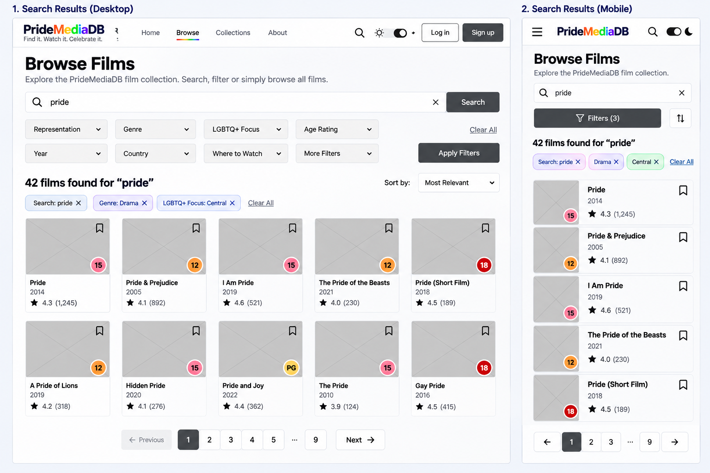

This wireframe shows the search interface and how matching films are displayed.

<strong>3. Film Detail Page</strong> (Click to expand)

#### Logged in and out film details Page

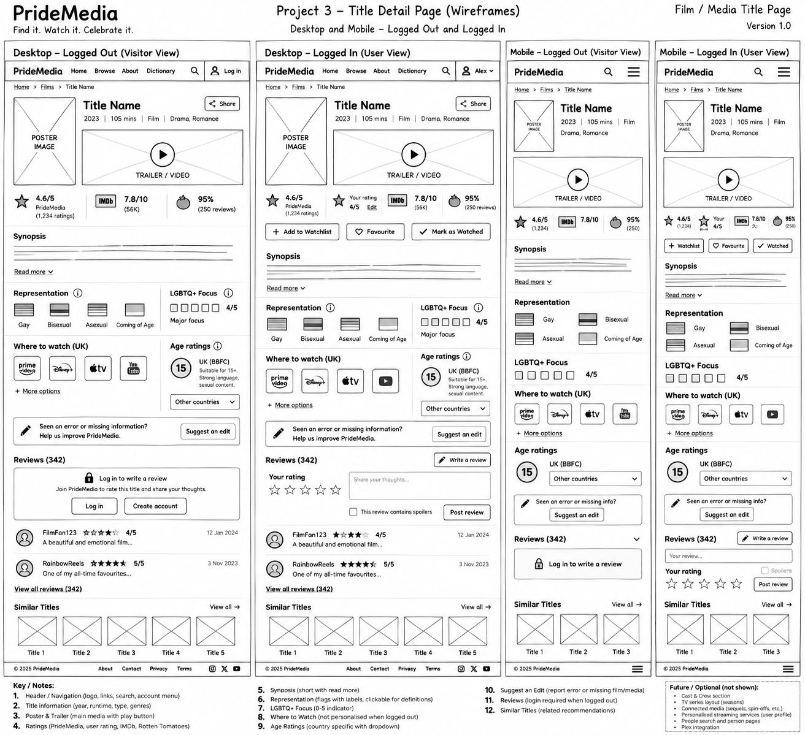

This wireframe shows the information displayed on an individual film page for visitors who are not signed in and users that are signed in.

***Note:*** _Where to watch (UK) is shown as a potential future enhancement. Implementation is subject to MoSCoW prioritisation and confirmation of a suitable data source; it is not currently a delivery commitment._

#### Alternative film detail designs

This image compares alternative film detail layouts.

.png)

This is another film detail concept to review alongside the other designs.

**TODO:** Compare the designs, identify duplicates or superseded versions, and agree on the final logged-out and logged-in layouts.

<strong>4. My Account and User Dashboard</strong> (Click to expand)

#### User dashboard

This wireframe explores the account dashboard available to signed-in users.

#### Alternative dashboard design

This design explores an alternative visual presentation for the user dashboard.

**TODO:** Review the designs and decide which account features should appear on the dashboard.

<strong>5. Registration and Login</strong> (Click to expand)

#### Registration

This page will allow new users to create an account.

#### Login

This page will allow existing users to sign in.

**TODO:** Create and review the registration and login wireframes.

<strong>6. Watchlist and Watched Films</strong> (Click to expand)

This page will allow signed-in users to view and manage saved films and, where supported, mark films as watched.

**TODO:** Create and review the wireframe.

<strong>7. Ratings and Reviews</strong> (Click to expand)

#### My ratings and reviews

This page will show the user's submitted ratings and reviews.

#### Add or edit a rating and review

This form will allow users to submit or update a rating and review.

**TODO:** Create and review the ratings and reviews wireframes.

<strong>8. Suggest a Film</strong> (Click to expand)

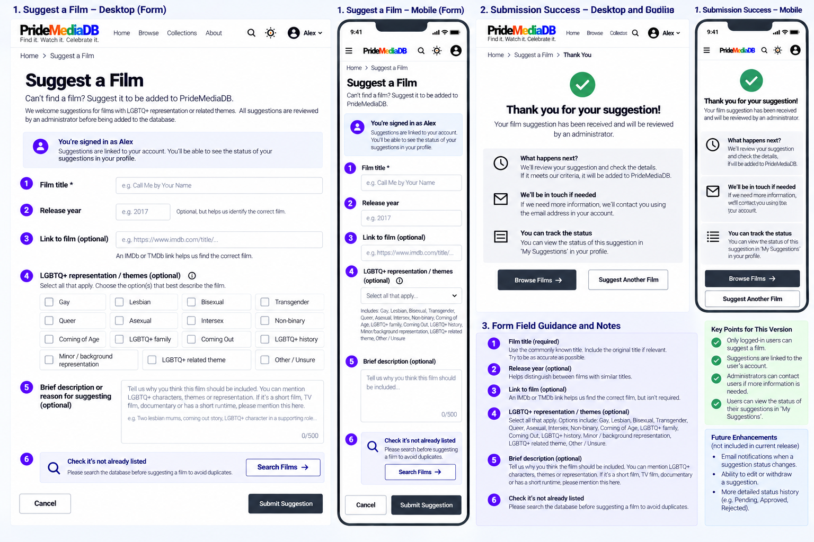

This page will allow signed-in users to suggest a film for inclusion in the database.

**TODO:** Create and review the wireframe.

<strong>9. Film Management</strong> (Click to expand)

This is a placeholder for a possible custom interface for managing film records.

**TODO:** Determine whether Django's built-in admin interface meets the project requirements before designing a custom page.

<strong>10. Film Suggestion Review</strong> (Click to expand)

This is a placeholder for a possible interface for reviewing submitted film suggestions.

**TODO:** Determine whether Django admin can handle suggestion reviews before designing a custom page.

<strong>11. Custom 404 Error Page</strong> (Click to expand)

This page will help users recover when they visit a page that cannot be found.

**TODO:** Create and review the custom 404 wireframe.

<strong>12. Responsive Layouts and Shared States</strong> (Click to expand)

This design provides a reference for how the homepage layout adapts to different screen sizes.

**TODO:** Review responsive layouts and identify any additional designs needed for mobile screens, form validation, empty search results and other shared states.

 

[Back to top](#pridemediadb)

---

## Features

[Back to top](#pridemediadb)

---

### Planned Features

[Back to top](#pridemediadb)

---

### Implemented Features

[Back to top](#pridemediadb)

---

### Responsive Design

[Back to top](#pridemediadb)

---

### User Authentication

[Back to top](#pridemediadb)

---

### Film Discovery and Search

[Back to top](#pridemediadb)

---

### Film Details and Representation

[Back to top](#pridemediadb)

---

### Ratings, Reviews and Watchlists

[Back to top](#pridemediadb)

---

## Database

[Back to top](#pridemediadb)

---

### Database Design

Database design began during the planning stage to identify the information PrideMediaDB needs to store and how different records relate to one another.

[ERD Plus](https://erdplus.com/) was used to explore the proposed entities, attributes and relationships and create two initial database-design diagrams:

- **Conceptual Entity Relationship Diagram (ERD):** illustrates the proposed entities, their attributes and relationships.
- **Relational Schema:** translates the conceptual design into database tables, including primary keys, foreign keys and relationships between tables. This schema was generated using ERDPlus from the conceptual design.

The initial design considers the project's main data requirements, including films, users, ratings, reviews, watchlists, watched status, film suggestions and LGBTQ+ representation.

These diagrams document the planning-stage design rather than a confirmed final database structure. The generated relational schema will be reviewed against the project's user stories, acceptance criteria and prioritised features as development progresses.

Following an Agile approach, the design may evolve as requirements are refined and implementation decisions are made. Test Driven Development (TDD) will guide implementation and help verify expected behaviour, including relevant model relationships, validation rules and data constraints.

Django models and migrations will be used to implement and manage the database structure. Depending on the relationships involved, Django may generate intermediary tables automatically or use explicitly defined models where additional fields or constraints are required.

The Django Models section will document the database structure actually implemented. The initial diagrams are retained as evidence of the design process and should not be interpreted as a guarantee that every proposed table or relationship will be included in the finished application.

[Back to top](#pridemediadb)

---

### Database Design Diagrams

The following diagrams illustrate the initial database-design process undertaken using ERDPlus.

<strong>Conceptual Entity Relationship Diagram</strong> (Click to expand)

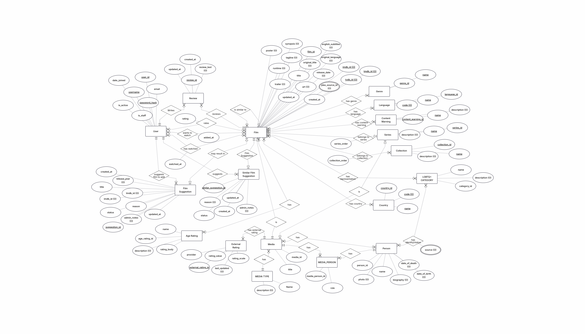

*Conceptual design showing the proposed entities, their attributes and relationships.*

 

<strong>Initial Relational Schema</strong> (Click to expand)

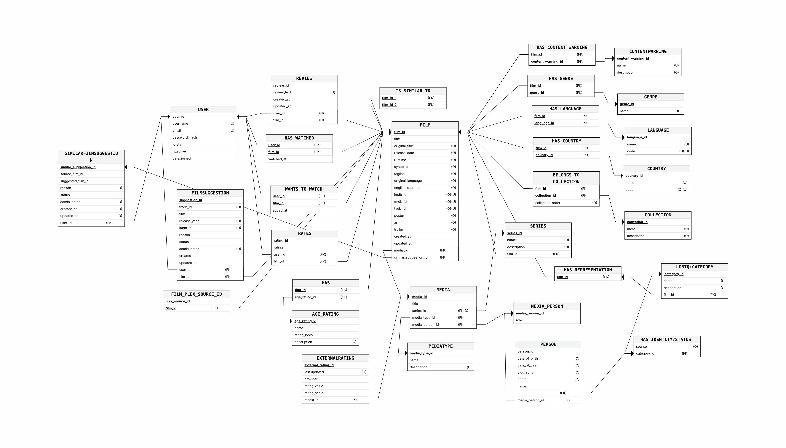

*Initial relational schema generated from the conceptual design, showing proposed tables, primary keys and foreign keys. The generated structure remains subject to review.*

 

[Back to top](#pridemediadb)

---

### Proposed Django Models

Django models will define the data stored by PrideMediaDB and the relationships between records in the database.

Based on the current project requirements, the proposed data models are expected to cover the following areas:

- **Films:** Store the core film information required for browsing, searching and viewing film details.
- **Ratings and reviews:** Store users' ratings and written reviews separately, linked to the relevant film and user.
- **Watchlist and watched status:** Record films users want to watch and films they have watched, associated with their accounts.
- **Film suggestions:** Store user-submitted film suggestions and their moderation status for administrator review.
- **Genres and representation categories:** Organise films using reusable categories to support browsing and exploration of LGBTQ+ representation.
- **Additional film metadata:** Support relevant information such as release dates, languages, countries, age ratings and external film identifiers where required by the agreed features.

Django's built-in authentication system will be considered when implementing user accounts. Relationships between models will be defined according to the data requirements, using foreign keys, many-to-many relationships and intermediary models where appropriate.

The proposed models will be refined during development to reflect the prioritised user stories, acceptance criteria and testing requirements. The initial ERD and relational schema provide a starting point rather than a fixed specification for every model or database table.

Django migrations will be used to apply model changes to the database. The actual model structure and relationships will be documented as implementation progresses.

[Back to top](#pridemediadb)

---

## API Integration

[Back to top](#pridemediadb)

---

### API Research

[Back to top](#pridemediadb)

---

### TMDb Integration

[Back to top](#tmdb-integration)

---

### API Feedback and Error Handling

[Back to top](#pridemediadb)

---

### Technologies Used

The following technologies, frameworks, APIs and development tools were used during the development of the PrideMediaDB site.

| Technology | Purpose |
|------------|---------|
| **[HTML5](https://developer.mozilla.org/docs/Web/HTML)** | Provides the semantic structure of the application. |
| **[CSS3](https://developer.mozilla.org/docs/Web/CSS)** | Creates the custom styling, responsive layout and animations. |
| **[Coolors](https://coolors.co/)** | Used to document the project's colour palette during the design process. |
| **[Git](https://git-scm.com/)** | Version control throughout development. |
| **[GitHub](https://github.com/)** | Repository hosting and version control. |
| **[Visual Studio Code](https://code.visualstudio.com/)** | Primary development environment. |
| **[RealFaviconGenerator](https://realfavicongenerator.net/)** | Used to generate the favicon package and platform-specific icons from the completed project logo. |
| **ChatGPT** | Used as an AI-assisted learning and development tool to discuss implementation approaches, **TODO:** add more as relevant |
| **[ERD Plus](https://erdplus.com/)** | As noted in [Database Design](#database-design) section; it was used to create two initial database-design diagrams and explore the proposed entities, attributes and relationships. |

<!-- **TODO:**
| **Lighthouse** | Used through Chrome DevTools to assess performance, accessibility, best practices and SEO throughout development. |
| **[W3C HTML Validator](https://validator.w3.org/)** | Used to validate the project's HTML for syntax errors and standards compliance. |
| **[W3C CSS Validator](https://jigsaw.w3.org/css-validator/)** | Used to validate the project's CSS and identify potential issues. |
| **[JSHint](https://jshint.com/)** | Used to analyse the JavaScript code for syntax errors, potential bugs and code quality improvements. |
| **[JavaScript](https://developer.mozilla.org/docs/Web/JavaScript)** | Implements the game logic, DOM manipulation, score tracking and API interaction. |
| **[Bootstrap 5](https://getbootstrap.com/)** | Used for the responsive grid system, navigation bar, accordion component and utility classes. |
| **[Fetch API](https://TBC)** | **TODO:**
| **[Google Fonts](https://fonts.google.com/)** | Provides the **TODO:**TO ADD  and **TODO:**TO ADD  typefaces used throughout the application. |
| **[GitHub Pages](https://pages.github.com/)** | Hosts the live application. |
| **[Image Robo](https://imagerobo.com/)** | Used to resize the custom card back image to match the Deck of Cards API dimensions (226 × 314 pixels). |
| **[Chrome DevTools](https://developer.chrome.com/docs/devtools/)** | Used for debugging, responsive testing and Lighthouse analysis. |
| **[PhotoRoom](https://www.photoroom.com/)** | Used to remove the background and create transparent edges for the custom card back image. |
| **[WebAIM Contrast Checker](https://webaim.org/resources/contrastchecker/)** | Used to verify colour contrast ratios and support accessibility testing. |
| **[Am I Responsive?](https://ui.dev/amiresponsive)** | Used to generate the responsive device mock-up image displayed within the project documentation. |

-->
 

[Back to top](#pridemediadb)

---

### Languages

[Back to top](#pridemediadb)

---

### Frameworks and Libraries

[Back to top](#pridemediadb)

---

### Database Technology

[Back to top](#pridemediadb)

---

### Development and Version Control

[Back to top](#pridemediadb)

---

## Testing

Details of the project's testing strategy, including automated testing and TDD, are documented in the separate Testing document.

[View Testing Documentation](docs/TESTING.md)

[Back to top](#pridemediadb)

---

## Deployment

[Back to top](#pridemediadb)

---

## Project Structure

[Back to top](#pridemediadb)

---

## Credits

[Back to top](#pridemediadb)

---

## References

[Back to top](#pridemediadb)

---

## Acknowledgements

[Back to top](#pridemediadb)

---

## Future Development

[Back to top](#pridemediadb)

---

## Reflections

[Back to top](#pridemediadb)
